# CI/CD Pipeline with GitHub Actions & Docker (No Cloud Needed)

This is my 2-week DevOps internship project based on **Project 4** of the Elevate Labs internship guidelines.

The goal of this project is to build an end-to-end CI/CD pipeline that tests a Python Flask API, packages it into a Docker container, and publishes the image to Docker Hub using GitHub Actions—without using any paid cloud services.

---

## Architecture Overview

```mermaid
flowchart LR
    Dev([Developer]) -->|git push| GH[GitHub Repository]
    GH -->|Trigger| GHA[GitHub Actions Runner]

    subgraph CI["Stage 1: Continuous Integration"]
        GHA --> Setup[Setup Python 3.12]
        Setup --> Install[Install Dependencies]
        Install --> Tests[Run Pytest Suite]
    end

    subgraph CD["Stage 2: Continuous Deployment"]
        Tests -->|Passed on main branch| Buildx[Setup Docker Buildx]
        Buildx --> Login[Docker Hub Login via Secrets]
        Login --> BuildPush[Build & Push Image]
    end

    BuildPush --> Hub[(Docker Hub Registry\nmythreyan26/devops-cicd-service)]
```



---

## Tools Used

- **Python 3.12 / Flask 3.1**: Simple, modular REST API.
- **Gunicorn 26.2**: Production WSGI HTTP server inside the container.
- **Pytest 9.1**: Automated unit tests, integration tests, and failure handling verification.
- **Docker**: Containerization using an official `python:3.12-slim` base image.
- **Docker Compose**: Local multi-container orchestration and port mapping.
- **GitHub Actions**: CI/CD pipeline automation for testing on pushes/pull requests and publishing on main pushes.
- **Docker Hub**: Container registry for hosting built images (`mythreyan26/devops-cicd-service`).

---

## Project Structure

```
DevOps-CICD-Project/
├── .github/
│   └── workflows/
│       └── ci-cd.yml          # GitHub Actions CI/CD workflow
├── app/
│   ├── __init__.py            # Flask application factory (create_app)
│   ├── config.py              # Environment configuration classes
│   ├── routes.py              # API routes and JSON error handlers
│   └── utils.py               # Timezone-aware UTC timestamping and math functions
├── tests/
│   ├── conftest.py            # Pytest test client fixtures
│   ├── test_health.py         # Tests for /health and /api/v1/info
│   └── test_api.py            # Math tests and deliberate failure-handling tests
├── .dockerignore              # Excludes .venv, cache, and secrets from Docker builds
├── .gitignore                 # Excludes local environments and test artifacts from git
├── Dockerfile                 # Container build instructions (non-root user, curl health check)
├── docker-compose.yml         # Local container orchestration file
├── PROJECT_STANDARDS.md       # Permanent engineering principles and guidelines
├── requirements.txt           # Python dependencies
├── wsgi.py                    # Entrypoint for running the app
└── README.md                  # Project documentation and setup guide
```

---

## Local Setup & Testing

### 1. Prerequisites
- Python 3.12+ (compatible with Python 3.14)
- Git
- Docker Desktop (with Docker Compose)

### 2. Set Up Virtual Environment
```bash
# Clone the repository (once pushed to GitHub)
git clone https://github.com/mythreyan26/DevOps-CICD-Project.git
cd DevOps-CICD-Project

# Create and activate virtual environment
python -m venv .venv

# On Windows (PowerShell):
.\.venv\Scripts\Activate.ps1

# On Linux/macOS:
source .venv/bin/activate
```

### 3. Install Dependencies
```bash
pip install -r requirements.txt
```

### 4. Run the Test Suite
```bash
pytest -v
```
All 22 automated tests should pass. The test suite covers positive calculation cases, invalid inputs, division by zero, booleans passed as numbers, and unknown routes.

### 5. Run the Flask App Locally
```bash
python wsgi.py
```
The application runs locally on `http://127.0.0.1:5000`.

---

## Running with Docker & Docker Compose

### 1. Build the Docker Image
```bash
docker compose build
```

### 2. Start the Container
```bash
docker compose up -d
```

### 3. Verify Container Health
```bash
docker compose ps
```
The container status will show `Up (healthy)` once the internal `/health` check succeeds.

### 4. View Container Logs
```bash
docker compose logs -f
```

### 5. Stop the Container
```bash
docker compose down
```

---

## API Endpoints

*(Note: In the responses below, timestamps are illustrative and will reflect your actual UTC request time.)*

### 1. Health Check (`GET /health`)
Used by Docker health checks and monitoring probes.
```bash
curl -i http://localhost:5000/health
```
**Response (200 OK):**
```json
{
  "status": "healthy",
  "timestamp": "<UTC ISO-8601 timestamp, e.g. 2026-10-18T08:44:52+00:00>"
}
```

### 2. Application Info (`GET /api/v1/info`)
Returns application name, version, Python runtime version, and environment.
```bash
curl -i http://localhost:5000/api/v1/info
```
**Response (200 OK):**
```json
{
  "app_name": "DevOps-CICD-Service",
  "environment": "production",
  "python_version": "3.12.15",
  "timestamp": "<UTC ISO-8601 timestamp, e.g. 2026-10-18T08:44:52+00:00>",
  "version": "1.0.0"
}
```

### 3. Arithmetic Calculator (`POST /api/v1/calculate`)
Supports `add`, `subtract`, `multiply`, and `divide`.
```bash
curl -i -X POST http://localhost:5000/api/v1/calculate \
  -H "Content-Type: application/json" \
  -d '{"operation": "multiply", "num1": 8, "num2": 9}'
```
**Response (200 OK):**
```json
{
  "operation": "multiply",
  "num1": 8.0,
  "num2": 9.0,
  "result": 72,
  "timestamp": "<UTC ISO-8601 timestamp, e.g. 2026-10-18T08:48:29+00:00>"
}
```

### 4. Failure Handling Demo (Division by Zero)
```bash
curl -i -X POST http://localhost:5000/api/v1/calculate \
  -H "Content-Type: application/json" \
  -d '{"operation": "divide", "num1": 10, "num2": 0}'
```
**Response (400 Bad Request):**
```json
{
  "error": "Bad Request",
  "message": "Division by zero is not allowed.",
  "timestamp": "<UTC ISO-8601 timestamp, e.g. 2026-10-18T08:45:41+00:00>"
}
```

---

## CI/CD Pipeline & GitHub Secrets

### GitHub Repository Secrets Needed
To allow GitHub Actions to push the built Docker image to Docker Hub, add these secrets under **Repository Settings > Secrets and variables > Actions**:

| Secret Name | Purpose | Example |
| :--- | :--- | :--- |
| `DOCKERHUB_USERNAME` | Docker Hub username | `mythreyan26` |
| `DOCKERHUB_TOKEN` | Docker Hub Personal Access Token (Read/Write) | `dckr_pat_...` |

> [!NOTE]
> Generate the access token in Docker Hub via **Account Settings > Security > Personal access tokens**. Never use your account password.

### Workflow Logic
- **Pull Requests to `main`**: Runs the `test` job only. If any test fails, the pull request check fails. Secrets are not exposed to PR runs.
- **Pushes to `main`**: Runs the `test` job first. If all tests pass, it proceeds to the `publish` job, logs into Docker Hub, builds the container, and tags it with `:latest` and `:${{ github.sha }}`.

---

## Security & Container Practices

1. **Non-Root User**: Inside the container, the application runs as `appuser` (UID 1000) instead of root to minimize host security risks.
2. **Lean Base Image**: Uses `python:3.12-slim` to reduce container footprint by omitting compiler toolchains and development packages not needed at runtime (verified at 226 MB uncompressed local disk usage, 54.8 MB compressed content size).
3. **No Hardcoded Secrets**: Docker Hub credentials are never stored in source code or committed configuration. They are configured as GitHub Actions repository secrets (`DOCKERHUB_USERNAME`, `DOCKERHUB_TOKEN`) and supplied only at pipeline runtime.
4. **Sanitized Error Responses**: Application errors return clean JSON messages without leaking internal tracebacks.

---

## Current Verification Status

- **Local Tests**: Verified (22/22 tests passing locally via pytest).
- **Local Container**: Verified (Docker Compose runs container healthy on port 5000).
- **Remote GitHub Actions**: Pending remote push and secret configuration.
- **Docker Hub Publish**: Pending push to GitHub.
